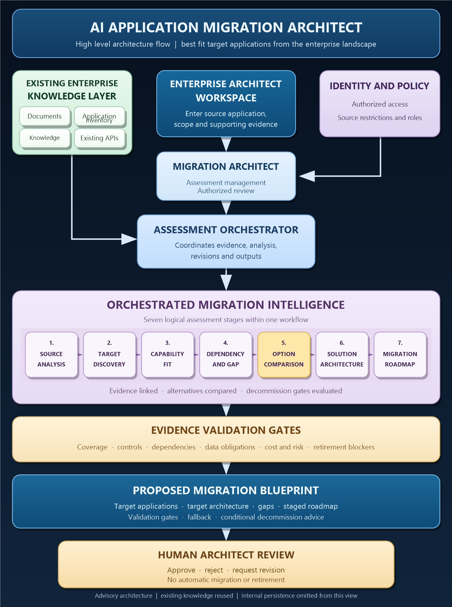

# AI Application Migration Architect — High Level Architecture

**Purpose**: Discover suitable target applications for an input application,
explain capability fit and gaps, assess decommission readiness, and produce a
reviewable migration blueprint. This is an advisory design, not an automated
migration or retirement tool.

## How to read this diagram

1. The architect supplies an application and assessment scope. The API
   authorizes the request using organization identity and access policies.
2. The workflow uses permitted facts from the existing enterprise knowledge
   layer. Missing, stale, conflicting, or restricted evidence remains
   visible as a safe gap instead of being treated as verified.
3. The seven stages are **logical steps within one assessment workflow**.
   The plan does not require seven separately deployed AI agents.
4. Rules compare source capabilities with possible target applications,
   explain alternatives and efficiency, check dependency and data
   obligations, and produce a staged target architecture.
5. The blueprint is a **proposal**. A human architect reviews the evidence
   and records approval, rejection, or a request for revision. The system
   does not execute migration or decommissioning.

## Intentional simplifications

- The separate knowledge adapter and its two arrows from the reference
  image are omitted. The implementation plan still requires a permission
  aware source contract behind the logical knowledge input.
- The migration-specific operational store box is omitted. The current
  plan still calls for persistent assessment revisions, jobs, decisions,
  and audit records; this diagram hides that internal detail.
- Product names such as Confluence, Neo4j, Entra ID, and Spring Boot are
  examples from the reference image, not required integrations in the
  generalized specification.

See the [feature specification](../specs/002-assess-application-fit/spec.md),
[implementation plan](../specs/002-assess-application-fit/plan.md), and
[decision record contract](../specs/002-assess-application-fit/contracts/decision-record.md)
for the detailed behavior.
