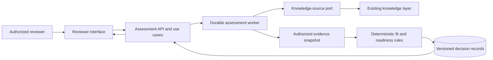

# Implementation Plan: Application Fit Assessment

**Branch**: `main` | **Date**: 2026-11-13 | **Spec**: [spec.md](spec.md)

**Input**: Feature specification from `specs/002-assess-application-fit/spec.md`

## Summary

Build an advisory application that examines an input application's capabilities and
dependencies against an existing landscape, recommends evidenced target placements,
reports conditional decommission readiness, and produces a staged transition
architecture and roadmap. The reference design is a modular web application:
knowledge-layer adapters create an authorized evidence snapshot; a deterministic
domain engine evaluates fit and retirement gates; a reviewer interface exposes
rationale, gaps, alternatives, and revision history. The feature never migrates or
retires applications automatically.

## Technical Context

**Language/Version**: Python 3.13 service; TypeScript 5 reviewer interface.
Use organization-supported patch releases at implementation time.

**Primary Dependencies**: FastAPI for service boundary and contract exposure;
React for interactive review; organization identity provider and knowledge-layer
adapters behind ports. Dependency versions will be locked during implementation.

**Storage**: PostgreSQL for assessment metadata, normalized claims, immutable
revisions, decisions, and audit references; source knowledge remains in its
authoritative systems. A durable job record coordinates long assessments.

**Testing**: pytest unit, contract, integration, and permission tests; browser
journey tests; deployment health and rollback checks.

**Target Platform**: Organization-approved Linux container environment.
The specific cloud, cluster, and CI system are deployment inputs.

**Project Type**: Web application with one modular service, reviewer interface,
and assessment worker sharing domain code.

**Performance Goals**: Under the pilot envelope, 95% of well-documented
assessments reach reviewable state within 5 minutes of submission; reviewers can
retrieve a decision record within 3 seconds at the 95th percentile. These
engineering targets support, but do not replace, the spec's 30-minute user goal.

**Constraints**: No autonomous migration or decommission action; no restricted
source disclosure in findings, exports, or logs; no verified claim or full parity
without valid evidence; every recommendation names ruleset and evidence revision.

**Scale/Scope**: Planning envelope of 500 applications, up to 100 capabilities
and 1,000 evidence references per assessment, and 50 concurrent reviewers.
Platform owners must confirm actual volumes before implementation sizing.

## Constitution Check

*GATE: Must pass before Phase 0 research. Re-check after Phase 1 design.*

| Principle or constraint | Before research | Design evidence |
|---|---|---|
| Clean architecture | PASS | Pure domain and ports/adapters proposed; see [research.md](research.md), Decision 1 |
| Security and data protection | PASS | Source and derived-result authorization, classification, and redacted audit planned; Decision 6 |
| Maintainability and traceability | PASS | Versioned rules, evidence lineage, and immutable assessment revisions planned; Decisions 3–5 |
| Automated testing | PASS | Rule, adapter, permission, journey, and release tests planned; Decision 7 |
| Reliable deployment | PASS | Reproducible image, gates, health checks, observability, and rollback planned; Decision 7 |
| Evidence and decommission constraints | PASS | Provenance statuses and human retirement gate planned; Decisions 4–5 |

No constitution violation requires a complexity exception. Phase 1 results
are recorded below after artifact review.

## Project Structure

### Documentation (this feature)

```text
specs/002-assess-application-fit/
├── spec.md
├── plan.md
├── research.md
├── data-model.md
├── quickstart.md
├── contracts/
│   ├── assessment-api.md
│   ├── knowledge-source.md
│   └── decision-record.md
└── tasks.md                 # Future $speckit-tasks output; not created here
```

### Source Code (repository root)

Proposed implementation layout; these paths are not created by this plan.

```text
backend/
├── app/
│   ├── domain/              # Claims, fit, disposition, readiness rules
│   ├── use_cases/           # Assessment, review, revision workflows
│   ├── ports/               # Knowledge, identity, storage, job contracts
│   ├── adapters/            # Source, persistence, identity implementations
│   ├── api/                 # User-facing service boundary
│   └── worker/              # Durable assessment execution
└── tests/
    ├── unit/
    ├── contract/
    └── integration/
frontend/
├── src/
│   ├── pages/               # Submission, fit matrix, roadmap, review
│   ├── components/
│   └── services/            # Assessment boundary client
└── tests/                   # Reviewer journey tests
ops/
└── deployment/              # Build, health, monitoring, rollback definitions
```

**Structure Decision**: Keep one backend domain package shared by API and worker.
The frontend consumes only the assessment contract. Knowledge sources are
replaceable adapters, and the database does not become a copy of the full
enterprise knowledge layer.

## Architecture Flow



1. Authenticate the reviewer and authorize the requested application and scope.
2. Retrieve only permitted source records through versioned knowledge adapters.
3. Normalize claims, preserve provenance, and expose conflicts, staleness, and gaps.
4. Freeze the assessment evidence snapshot and ruleset version.
5. Classify capability coverage and compare target alternatives using explicit
   business value, effort, duplication, risk, and operating-impact criteria.
6. Evaluate dependency, data, operational, and owner-attestation retirement gates.
7. Derive a staged current-to-target architecture and roadmap with prerequisites,
   validation gates, owners, and fallbacks.
8. Publish a reviewable decision record; later corrections create a new revision
   and show what changed. Human approval remains separate from the recommendation.

## Phase 0: Research

The decisions and rejected alternatives are documented in [research.md](research.md).
Unknown source schemas, hosting details, identity claims, and retention rules are
bounded by contracts and organization-owned configuration inputs. They do not
prevent a generic design; they must be supplied before a production integration
or release.

## Phase 1: Design

- [data-model.md](data-model.md) defines normalized application, capability,
  evidence, assessment, recommendation, approval, and roadmap entities.
- [contracts/assessment-api.md](contracts/assessment-api.md) defines the reviewer
  boundary and permission outcomes.
- [contracts/knowledge-source.md](contracts/knowledge-source.md) defines source
  adapter behavior and failure states.
- [contracts/decision-record.md](contracts/decision-record.md) defines the
  reviewable output.
- [quickstart.md](quickstart.md) defines end-to-end validation scenarios for the
  eventual implementation.

## Post-Design Constitution Check

| Gate | Result | Evidence |
|---|---|---|
| Domain independent of adapters | PASS | Proposed source layout; [knowledge-source.md](contracts/knowledge-source.md) |
| Authorized, minimal, classified data | PASS | [knowledge-source.md](contracts/knowledge-source.md) and [assessment-api.md](contracts/assessment-api.md) |
| Traceable rules and decisions | PASS | Immutable revisions, claim provenance, and human decisions in [data-model.md](data-model.md) |
| Automated verification | PASS | Adapter and permission contracts; scenarios in [quickstart.md](quickstart.md) |
| Reliable release | PASS | Health, quality, monitoring, and rollback decisions in [research.md](research.md) |
| Evidence and human decommission gate | PASS | [decision-record.md](contracts/decision-record.md) and DecommissionGate model |

**Gate conclusion**: Phase 1 design may proceed to task generation. Before
production implementation, organization owners must provide source schemas,
access policies, retention rules, hosting standards, and actual scale targets
listed in [research.md](research.md). No design gate remains unresolved.
